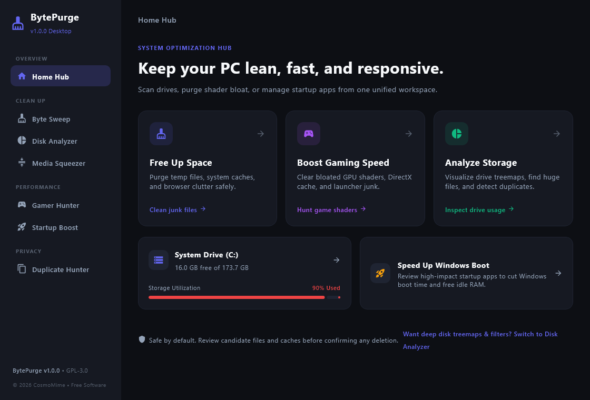
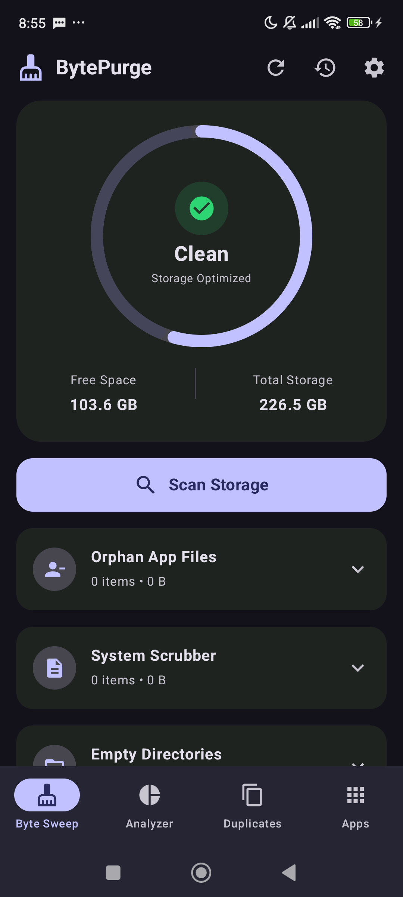

<div align="center">

# 🧹 BytePurge

**Fast, thorough storage cleaner, shader cache hunter, and disk analyzer for Android & Windows.**

[](https://www.gnu.org/licenses/gpl-3.0)
[](#)
[](https://kotlinlang.org/)
[](https://www.jetbrains.com/lp/compose-multiplatform/)

*Free and open source. No subscriptions. No ads. No telemetry. Just clean, honest byte-level system optimization.*

<br/>

<p align="center">
  
  &nbsp;
  
</p>

</div>

---

## 🌟 Core Pillars

- 🛡️ **Safe & Local Processing**: All scanning and file inspections execute strictly on your device. Safe by default—review candidate files before confirming any deletion.
- 🎨 **Modern Cyber-Obsidian Design**: True dark interface crafted with Jetpack Compose (Android) and Compose Multiplatform (Windows Desktop).
- 🎮 **Gamer-Centric Optimization**: Dedicated tools to hunt gigabytes of hidden DirectX, Vulkan, AMD, and NVIDIA pre-compiled shader pipelines, launcher vault caches, and game logs.
- ⚡ **Zero Bloat, Zero Nagware**: No background services consuming idle RAM, no fake "RAM booster" animations, and no commercial paywalls.
- 🔍 **Precision Storage Intelligence**: Deep folder heatmaps, heavy file radar, real-time uninstallation detection, and SHA-256 cryptographic duplicate detection.

---

## ✨ Key Features

### 🏠 System Optimization Hub (Desktop)
A clean, unified desktop home interface built for quick, goal-driven actions:
- **Free Up Space**: Instantly scan and purge temporary files, app logs, and browser clutter.
- **Boost Gaming Speed**: Target bloated GPU shaders, game launcher caches, and DirectX debris.
- **Analyze Storage**: Jump directly into disk treemaps, pinpoint massive files, and detect duplicates.
- **Live Drive Health Gauge**: Real-time System Drive (C:) utilization meter and Windows boot optimizer.

### 🎮 Gamer Ghost Cache & Shader Hunter (Desktop)
Games frequently leave behind tens of gigabytes of pre-compiled shader blobs and web caches that standard Windows disk cleanup tools ignore:
- **DirectX 12 Shader Pipeline** (`%LOCALAPPDATA%\D3DSCache`)
- **NVIDIA & AMD Driver Caches**: `%LOCALAPPDATA%\NVIDIA\DXCache`, `NV_Cache`, `AppData\LocalLow\NVIDIA\PerDriverVersion`, and AMD `DxCache`, `GLCache`, `VkCache`.
- **Steam Shader Pre-Cache**: Stale compiled shaders in `Steam\steamapps\shadercache`.
- **Epic Games VaultCache**: Pre-downloaded game chunks and staging caches (often 30–80 GB).
- **Game Launcher Caches**: Steam CEF Web Cache, EA Desktop App, Origin Legacy, Ubisoft Connect, Rockstar Games Launcher, Xbox App cache, Battle.net, and GOG Galaxy.
- **Engine Shaders**: Unity Engine shader caches (`%LOCALAPPDATA%\Unity\cache`).

### 🧹 Byte Sweep: Deep Disk & Cache Sanitation
- **Windows**: Windows Temp, User Temp, SoftwareDistribution download cache, crash dumps, and minidumps.
- **Browser Caches**: Google Chrome, Microsoft Edge, Brave, Opera, Opera GX, and Vivaldi.
- **App Data Caches**: Visual Studio Code, Discord, and Spotify.
- **Android**: App caches, orphaned files left behind by uninstalled apps, empty folder hierarchies, and system logs.

### 📱 Smart App Manager & Uninstaller (Android)
- **100% Full-Screen Scroll**: Summary and permission banners scroll away naturally inside the list for maximum screen browsing.
- **Instant Uninstallation**: 1-tap direct uninstallation buttons with compact ~70dp cards showing monospace package IDs, APK sizes, and app data breakdown.
- **Real-Time Package Removal**: Integrated `BroadcastReceiver` (`ACTION_PACKAGE_REMOVED`) and activity result callbacks ensure uninstalled apps vanish instantly without requiring a manual refresh.
- **Rootless System Cache Trimming**: Optional Shizuku Wireless ADB integration to execute `pm trim-caches` across all applications without root.
- **APK Archiver**: One-tap APK extraction and APK sharing.

### 📊 Storage Analyzer & Big Files Radar
- **Volume Heatmaps & Health Bars**: Standardized volume breakdown for mounted drives with 3-tier health indicators.
- **Deep Target Directory Inspection**: Target your home directory or browse any custom folder (e.g. `SteamLibrary`, `Downloads`, VMs).
- **Sleek Size Filter Chips & Fast Search**: Instantly isolate files exceeding 25 MB, 50 MB, 100 MB, 500 MB, or 1 GB.
- **Categorized File Badges**: Visual indicators for executables, archives, media, virtual disks, and audio.

### 📸 Visual Media Purger (Android)
- **3-Column Photo Gallery**: Visually inspect forwarded photos, memes, and stickers before deleting.
- **Audio Voice Note Preview**: Integrated audio player card with instant play/pause to listen to voice notes before purging.
- **Batch Deletion**: One-tap selection per category with live reclaimed storage estimation.

### 👯 Duplicate File Hunter
- **Cryptographic SHA-256 Hashing**: 100% accurate identical file detection (zero false positives).
- **Smart Preservation**: "Keep Oldest (Original)" or "Keep Cleanest Path" auto-selection.

### ⚡ Windows Startup Boost
- Manage autorun registries (`HKCU\Run`, `HKLM\Run`) and Startup folders with safety timeouts and zero background footprint.

---

## 💻 Tech Stack

- **Languages**: 100% Kotlin
- **Android**: Jetpack Compose, Material 3, AndroidX Storage Framework
- **Desktop**: Compose Multiplatform for Desktop (Skia-rendered native Windows binary)
- **Architecture**: MVI / MVVM, Coroutines, StateFlow, Reactive State Management
- **Packaging**: Standalone Windows UberJAR / Native Executable & Android APK

---

## 🛠️ Building From Source

### Prerequisites
- JDK 17 or higher
- Android SDK (API 34+)

### 1. Build Android APK
```bash
./gradlew :app:assembleDebug
```
The output APK will be at `app/build/outputs/apk/debug/app-debug.apk`.

### 2. Build Desktop Windows App
```bash
./gradlew :desktop:packageUberJarForCurrentOS
```
The standalone runnable JAR will be at `desktop/build/compose/jars/BytePurge-windows-x64-1.0.0.jar`.

To run directly during development:
```bash
./gradlew :desktop:run
```

---

## 💖 Sponsoring & Supporting Development

BytePurge is independent, free, and open-source software under GPL-3.0. If BytePurge helped reclaim your storage and keep your PC or phone running fast, please consider supporting continued open-source development!

- **GitHub Sponsors**: [github.com/sponsors/cosmomime](https://github.com/sponsors/cosmomime) *(0% platform fee)*
- **Patreon**: [patreon.com/CosmoMime](https://www.patreon.com/CosmoMime)

---

## 📄 License

BytePurge is licensed under the **GNU General Public License v3.0 (GPLv3)**. See [LICENSE](LICENSE) for full details.

```
BytePurge - Fast, thorough storage cleaner, shader cache hunter, and disk analyzer
Copyright (C) 2026 BytePurge Contributors

This program is free software: you can redistribute it and/or modify
it under the terms of the GNU General Public License as published by
the Free Software Foundation, either version 3 of the License, or
(at your option) any later version.
```
