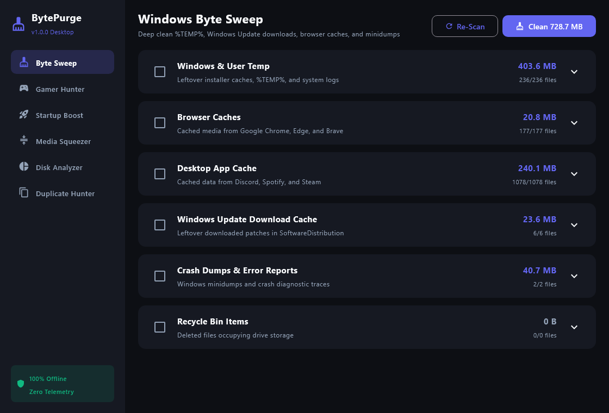

<div align="center">

# 🧹 BytePurge

**The offline, privacy-first, zero-telemetry storage cleaner, disk analyzer, and shader hunter for Android & Windows.**

[](https://www.gnu.org/licenses/gpl-3.0)
[](#)
[](https://kotlinlang.org/)
[](https://www.jetbrains.com/lp/compose-multiplatform/)
[](#)

*No subscriptions. No full-screen ads. No telemetry. Just clean, honest byte-level storage reclamation.*

<br/>

<p align="center">
  
  &nbsp;
  
</p>

</div>

---

## 🌟 Core Pillars

- 🛡️ **100% Offline & Private**: Zero network permissions required for core cleaning. No analytics, no tracking, and no phoning home.
- 🎨 **Modern Obsidian Design**: True OLED dark interface crafted with Jetpack Compose (Android) and Compose Multiplatform (Windows Desktop).
- 🎮 **Gamer-Centric**: Dedicated tools to hunt gigabytes of hidden DirectX, AMD, and NVIDIA pre-compiled shader pipelines and game launcher caches.
- ⚡ **Zero Bloat, Zero Nagware**: No background services consuming memory, no fake "RAM booster" animations, and no subscription paywalls.
- 🔍 **Precision Storage Intelligence**: Deep folder heatmaps, heavy file radar, and SHA-256 cryptographic duplicate detection.

---

## ✨ Key Features

### 🎮 Gamer Ghost Cache & Shader Hunter (Desktop)
Games frequently leave behind gigabytes of pre-compiled shader blobs and web caches that standard disk cleanup tools ignore:
- **DirectX 12 Shader Pipeline** (`%LOCALAPPDATA%\D3DSCache`)
- **NVIDIA & AMD Radeon Shader Caches** (`NVIDIA\DXCache`, `AMD\DxCache`)
- **Game Launcher Caches**: Steam CEF Web Cache, Epic Games, EA Desktop, Ubisoft Connect, Battle.net, and GOG Galaxy.
- **Offline Match Replays**: Safe detection of temporary replay buffers and emulator sync files.

### 🧹 Byte Sweep: Deep Disk & Cache Sanitation
- **Windows**: Windows Temp, User Temp, SoftwareDistribution download cache, crash dumps, and browser caches (Chrome, Edge, Brave).
- **Android**: App caches, orphaned files left behind by uninstalled apps, empty folder hierarchies, and system logs.

### 📊 Storage Analyzer & Big Files Radar
- **Volume Heatmaps & Health Bars**: Standardized volume breakdown for mounted drives with 3-tier health indicators.
- **Deep Target Directory Inspection**: Target your home directory or browse any custom folder (e.g. `SteamLibrary`, `Downloads`, VMs).
- **Sleek Size Filter Chips & Fast Search**: Instantly isolate files exceeding 25 MB, 50 MB, 100 MB, 500 MB, or 1 GB.
- **Categorized File Badges**: Visual indicators for executables, archives, media, virtual disks, and audio.

### 📸 Visual Media Purger (Android)
- **3-Column Photo Gallery**: Visually inspect forwarded photos, memes, and stickers before deleting.
- **Audio Voice Note Preview**: Integrated audio player card with instant play/pause to listen to voice notes before purging.
- **Batch Deletion**: One-tap selection per category with live reclaimed storage estimation.

### 👯 Duplicate File Hunter
- **Cryptographic SHA-256 Hashing**: 100% accurate identical file detection (zero false positives).
- **Smart Preservation**: "Keep Oldest (Original)" or "Keep Cleanest Path" auto-selection.

### ⚡ Windows Startup Boost
- Manage autorun registries, Startup folders, and Task Manager launch impact with zero background footprint.

---

## 💻 Tech Stack

- **Languages**: 100% Kotlin
- **Android**: Jetpack Compose, Material 3, AndroidX Storage Framework
- **Desktop**: Compose Multiplatform for Desktop (Skia-rendered native Windows binary)
- **Architecture**: MVI / MVVM, Coroutines, StateFlow, Reactive State Management
- **Packaging**: Standalone Windows UberJAR / Native Executable & Android APK

---

## 🛠️ Building From Source

### Prerequisites
- JDK 17 or higher
- Android SDK (API 34+)

### 1. Build Android APK
```bash
./gradlew :app:assembleDebug
```
The output APK will be at `app/build/outputs/apk/debug/app-debug.apk`.

### 2. Build Desktop Windows App
```bash
./gradlew :desktop:packageUberJarForCurrentOS
```
The standalone runnable JAR will be at `desktop/build/compose/jars/BytePurge-windows-x64-1.0.0.jar`.

To run directly during development:
```bash
./gradlew :desktop:run
```

---

## 💖 Sponsoring & Supporting Development

BytePurge is independent, free, and open-source software. If BytePurge saved you disk space or saved you from commercial cleaner subscriptions, please consider supporting development!

- **GitHub Sponsors**: [github.com/sponsors/cosmomime](https://github.com/sponsors/cosmomime) *(0% platform fee)*

All sponsors are credited in our in-app **Hall of Fame**!

---

## 📄 License

BytePurge is licensed under the **GNU General Public License v3.0 (GPLv3)**. See [LICENSE](LICENSE) for full details.

```
BytePurge - Offline, privacy-first storage cleaner and shader hunter
Copyright (C) 2026 BytePurge Contributors

This program is free software: you can redistribute it and/or modify
it under the terms of the GNU General Public License as published by
the Free Software Foundation, either version 3 of the License, or
(at your option) any later version.
```
